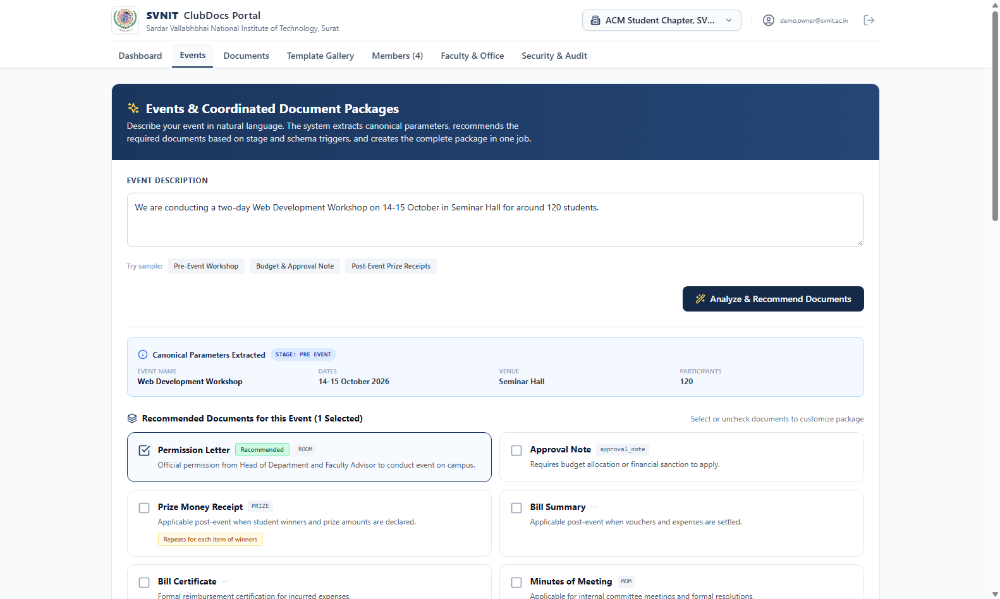
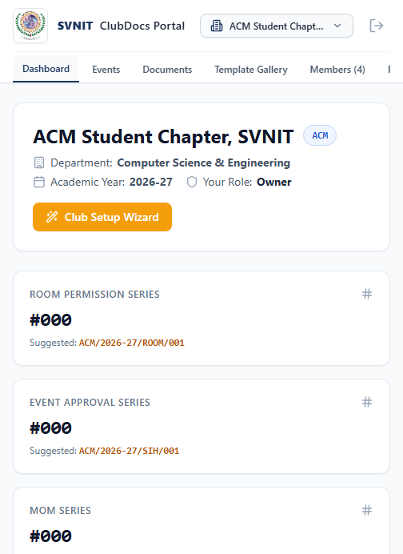
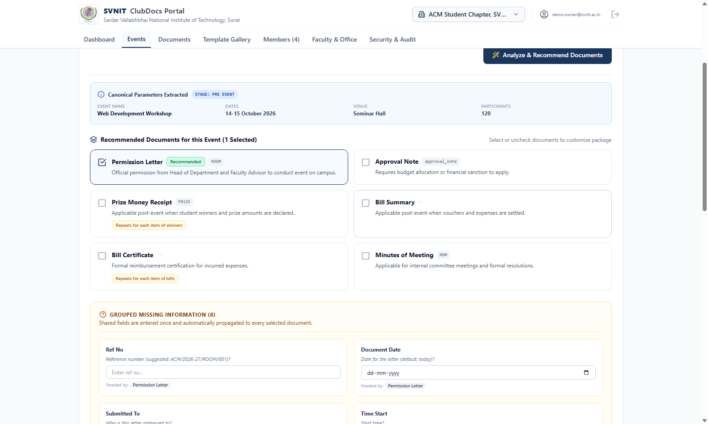
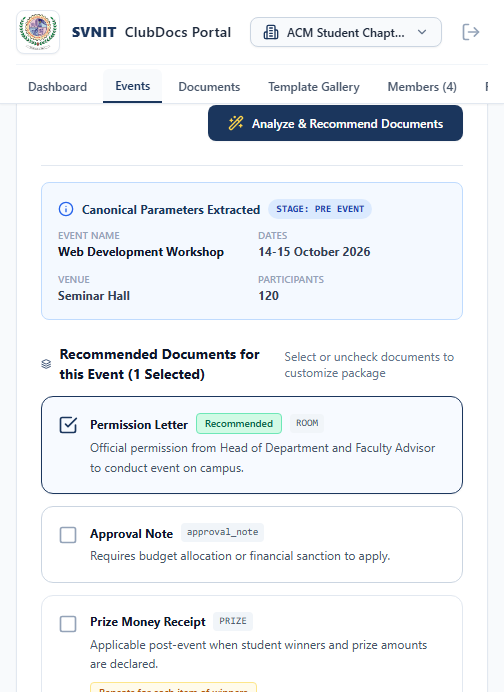
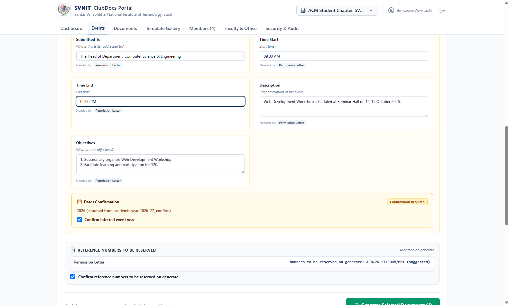
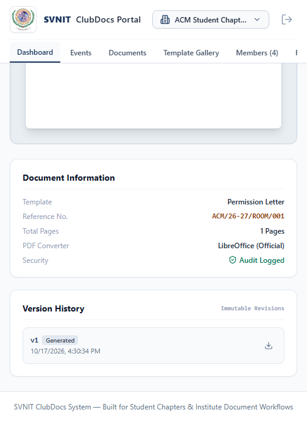

# SVNIT ClubDocs — Official Document Generation Platform

The official, template-driven document generation, serial numbering, and approval preparation platform for student chapters and clubs at **Sardar Vallabhbhai National Institute of Technology (SVNIT), Surat**.

---

## ⏱️ 10-Minute Quick Start for a New Club Member (Windows PowerShell)

Get up and running locally in under 10 minutes:

```powershell
# 1. Clone repository & open folder
cd C:\Users\OMEN\Desktop\DocumentGenerator

# 2. Activate Python virtual environment
.\.venv\Scripts\Activate.ps1

# 3. Verify system readiness (Python, LibreOffice, Database, Crypto)
python -m server.scripts.doctor

# 4. Start the unified web server (Frontend + Backend on port 8000)
python -m uvicorn server.app.main:app --port 8000
```

> **Open your browser at:** [http://localhost:8000](http://localhost:8000)  
> Sign in with the demo account: `demo.owner@svnit.ac.in` / `DemoOwnerPass123!` (or join via an invite link provided by your club admin).

---

## 📸 System Screenshots

| Desktop Workflow (1600px) | Mobile Experience (390px) |
| :--- | :--- |
|  |  |
| *Event Description & Recommended Documents* | *Mobile Dashboard at 390px Viewport* |
|  |  |
| *Grouped Missing-Info Panel with Propagation* | *Mobile Grouped Input (Zero Horizontal Scroll)* |
|  |  |
| *Batch Package Generation & Atomic Numbering* | *Document Review, Version History & PDF Download* |

---

## 🛡️ Access Roles & Permission Boundaries

SVNIT ClubDocs enforces strict club-level tenancy and granular role-based permissions:

| Role | Hierarchy Rank | Access Scope & Capabilities |
| :--- | :---: | :--- |
| **Platform Admin** | *Global* | Institute superuser across all clubs, system templates, and system audits. |
| **Club Owner** | `Rank 4` | Full club authority: create/delete clubs, transfer ownership, assign all roles, generate invites, upload letterheads. |
| **Club Admin** | `Rank 3` | Administrative control: manage members, configure numbering series formats, manage venues, create editor/viewer invites, reveal masked contacts. |
| **Lead / Co-Lead** | `Rank 3` | Official chapter leadership: draft, review, and finalize documents, assign event committees. |
| **Treasurer** | `Rank 2.5` | Financial custodian: verify vouchers, edit bill certificates, approve bill summaries and expenditure totals. |
| **Faculty Advisor** | `Rank 2` | Official faculty patron: review permissions and sanction notes before submission to HoD/Dean. |
| **Editor** | `Rank 2` | Document author: draft packages, edit event parameters, accept AI drafts; read-only access to venues and numbering. |
| **Viewer** | `Rank 1` | Read-only member: view finalized documents and active events; cannot draft or create invites. |

---

## 🏛️ How to Add a Club

1. Log in with a platform admin or club creator account.
2. Open the **Club Switcher** dropdown in the top navigation bar and click **"+ Register New Club"** (or run the first-run Setup Wizard).
3. Specify:
   - **Full Club Name**: e.g., *Association for Computing Machinery (ACM) Student Chapter*
   - **Short Code / Acronym**: e.g., *ACM*
   - **Affiliated Department**: e.g., *Department of Computer Science & Engineering*
   - **Default Academic Year**: e.g., *2026-27*
4. Click **Create Club**. The platform automatically provisions the club's isolated database space, initial numbering series (`ACM/26-27/DOC/001`, `ACM/26-27/ROOM/001`), and creates the default institutional letterhead.

---

## 📝 How to Create a Template

The portal offers 3 ways to create and customize document templates:

1. **Template Gallery (Forking)**:
   - Navigate to the **Template Gallery** tab.
   - Browse standard SVNIT templates (Permission Letter, Approval Note, Bill Certificate, Bill Summary, Prize Money Receipt, MoM).
   - Click **Fork Template** to create a club-specific editable variant.
2. **Interactive Visual Template Editor**:
   - Open any custom template in the **Template Editor**.
   - Customize letterhead headers, clause paragraphs, dynamic tables, and 2x2 signature grids.
   - Test live rendering against mock sample data.
3. **Describe-by-Text (AI-Assisted Template Drafting)**:
   - In the Template Gallery, click **"Draft with AI"**.
   - Enter your requirements in natural language: e.g., *"Create an equipment gate pass letter to the Chief Security Officer requesting to take 4 laptops outside campus for a robotics competition."*
   - The engine automatically drafts the schema fields, Jinja2 template body, and signatory blocks for your review and approval.

---

## 📦 How to Generate a Document Package

1. Navigate to the **Events** tab.
2. **Describe Your Event**: Type a single natural-language sentence into the box:
   > *"We are conducting a two-day Web Development Workshop on 14-15 October in Seminar Hall for around 120 students."*
3. Click **Analyze & Recommend Documents**.
4. **Review Recommended Package**: The system automatically recommends the required documents based on event stage (e.g. Permission Letter + Event Approval Note).
5. **Complete Missing Parameters**: Enter shared fields once in the **Grouped Missing Information** panel (e.g. daily timings, submitted-to authority). Accept any AI-drafted text explicitly.
6. **Confirm Serial Numbers & Academic Year**: Verify the suggested serial numbers and confirm the inferred academic year.
7. **Generate Selected Documents**: Click generate. The engine atomically reserves unique serial numbers, compiles DOCX files, renders official PDFs via LibreOffice, logs the audit trail, and packages everything into a downloadable ZIP archive.

---

## 🚫 What the System Never Does (Institutional Integrity Guarantees)

SVNIT ClubDocs is designed strictly around official institutional document governance rules:

1. **Never Invents Official Details**:
   The engine **never** fabricates event timings, participant figures, financial amounts, bill numbers, dates, or venues. If a required field is not provided, the batch is rejected with `400 MISSING_REQUIRED_FIELDS` and a grouped list.
2. **Never Fabricates Approval Signatories**:
   The system never invents names, designations, or authority signatures. Signatories are pulled strictly from the verified club roster and campus faculty directory.
3. **Never Silently Emits AI Drafts into Official PDFs**:
   Any AI-suggested text (e.g. description or objectives) remains marked as `[AI-drafted, review]`. Batch generation is strictly blocked until a human club officer explicitly edits or accepts the draft. The tag is never stripped silently.
4. **Never Re-numbers Historical Documents**:
   Updating a numbering series format applies **only to future documents**. Historical documents permanently retain their originally allocated dispatch numbers in the audit registry.
5. **Never Consumes Serial Numbers on Failed Jobs**:
   Serial number reservation and document rendering are executed within an atomic transaction. If rendering fails, the reservation is cleanly rolled back with zero consumed numbers and no serial number gaps.

---

## 🧪 Testing & Verification

The reproducible offline check is:

```bash
make test
```

It compiles the backend and runs the locked frontend build. It does not require
network access or external AI credentials. For the full Python test suite (when
the development dependencies are installed), run:

Run the comprehensive test suite in PowerShell (foreground, isolated SQLite test DB):

```powershell
python -m pytest -q --timeout=300 -p no:cacheprovider
```

All tests execute strictly against an isolated database; `data/clubdocs.db` remains pristine and untouched.

---

## 📦 How to Share Your Project

To generate a clean, safe distribution zip that strictly excludes all secrets (`.env`), virtual environments (`.venv`), databases (`data/*.db*`), storage files, sample forms, and large dependencies (`node_modules`), run:

```powershell
powershell -ExecutionPolicy Bypass -File scripts/make_share_zip.ps1
```

This generates `clubdocs_share.zip` in the root directory (typically under 10 MB) safe for public transfer and code reviews.

---

## 📚 Documentation Links

- [AI Setup & Gemini Configuration Guide](docs/AI_SETUP.md)
- [Non-Technical Club Member User Guide](docs/USER_GUIDE.md)
- [Official Numbering Specification](docs/NUMBERING_SPEC.md)
