"""Mermaid Entity-Relationship Diagram and Database Schema Reference for ClubDocs.

Generated for Phase W1.
"""

# ClubDocs Database Schema

This document details the normalized relational database schema designed for ClubDocs (Phase W1).
All tables feature UUID primary keys, timestamp tracking (`created_at`, `updated_at`), and strict club scoping indices.

```mermaid
erDiagram
    USERS ||--o{ MEMBERSHIPS : "has"
    CLUBS ||--o{ MEMBERSHIPS : "has"
    CLUBS ||--o{ INVITES : "issues"
    CLUBS ||--o{ ASSETS : "owns"
    CLUBS ||--o{ LETTERHEADS : "configures"
    CLUBS ||--o{ PEOPLE : "registers"
    CLUBS ||--o{ ROLES_HELD : "assigns"
    PEOPLE ||--o{ ROLES_HELD : "held_by"
    CLUBS ||--o{ VENUES : "manages"
    CLUBS ||--o{ NUMBERING_SERIES : "tracks"
    CLUBS ||--o{ EVENTS : "organizes"
    CLUBS ||--o{ TEMPLATES : "creates/forks"
    TEMPLATES ||--o{ TEMPLATE_VERSIONS : "versions"
    EVENTS ||--o{ DOCUMENTS : "groups"
    CLUBS ||--o{ DOCUMENTS : "owns"
    TEMPLATES ||--o{ DOCUMENTS : "instantiates"
    DOCUMENTS ||--o{ DOCUMENT_VERSIONS : "versions"
    CLUBS ||--o{ JOBS : "runs"
    CLUBS ||--o{ CLAUSES : "defines"
    CLUBS ||--o{ AI_REQUESTS : "logs"
    CLUBS ||--o{ AUDIT_LOG : "audits"

    USERS {
        string id PK "UUID"
        string email UK "unique index"
        string password_hash
        string name
        boolean is_platform_admin
        datetime email_verified_at
        datetime last_login_at
        datetime disabled_at
    }

    CLUBS {
        string id PK "UUID"
        string name
        string short_name
        string slug UK "unique index"
        string chapter_code
        string head_of_account
        string academic_year_default
        string default_letterhead_id
        json settings "defaults, approval_chain, etc."
        datetime disabled_at
    }

    MEMBERSHIPS {
        string id PK "UUID"
        string user_id FK
        string club_id FK
        string role "owner|admin|editor|viewer"
        string status "active|invited|disabled"
    }

    ASSETS {
        string id PK "UUID"
        string club_id FK "nullable for system assets"
        string kind "logo|letterhead|signature|other"
        string filename
        string mime
        string sha256
        int size
        string storage_key
        string uploaded_by
        boolean is_system
    }

    LETTERHEADS {
        string id PK "UUID"
        string club_id FK "nullable for system"
        string name
        string left_logo_asset_id
        string right_logo_asset_id
        string institute_logo_asset_id "locked SVNIT logo"
        string title_text
        string subtitle_text
        json colors
        json fonts
        string footer_text
        json layout
    }

    PEOPLE {
        string id PK "UUID"
        string club_id FK
        string full_name
        string roll_no
        string branch
        string department
        string mobile "encrypted at rest"
        string email
        string notes
    }

    ROLES_HELD {
        string id PK "UUID"
        string club_id FK
        string person_id FK
        string role_key "student_head|chairperson|faculty_chairman"
        string designation_label
        datetime valid_from
        datetime valid_to
        string academic_year
    }

    VENUES {
        string id PK "UUID"
        string club_id FK "nullable for shared campus venues"
        string name
        string short_name
        string addressee_default
        string tech_assistant_person_id
        string faculty_incharge_person_id
    }

    TEMPLATES {
        string id PK "UUID"
        string club_id FK "nullable for system templates"
        string slug "indexed"
        string name
        string description
        string category
        string stage "pre_event|post_event|meeting"
        boolean is_system
        string forked_from_template_id
        string status "draft|published|archived"
        string current_version_id
    }

    TEMPLATE_VERSIONS {
        string id PK "UUID"
        string template_id FK
        int version_no
        text schema_yaml
        json editor_json "TipTap JSON"
        string docx_storage_key
        string letterhead_id
        json validation_report
        string created_by
        string change_note
    }

    NUMBERING_SERIES {
        string id PK "UUID"
        string club_id FK
        string key "ROOM|MOM|<event_code>"
        string format
        string academic_year
        int last_seq
    }

    EVENTS {
        string id PK "UUID"
        string club_id FK
        string title
        string event_code
        json record "Canonical EventRecord"
        string status
        string created_by
    }

    DOCUMENTS {
        string id PK "UUID"
        string club_id FK
        string event_id FK
        string template_id FK
        string template_version_id FK
        string title
        string ref_no
        string status "draft|needs_info|ready|finalized"
        string current_version_id
        string created_by
    }

    DOCUMENT_VERSIONS {
        string id PK "UUID"
        string document_id FK
        int version_no
        json record_snapshot
        json overrides
        string docx_key
        string pdf_key
        string diff_summary
        string created_by
        string source "generated|manually_edited_upload"
    }

    JOBS {
        string id PK "UUID"
        string club_id FK
        string kind "render|pdf|batch|ai"
        string status "queued|running|completed|failed"
        json payload
        json result
        string error
        datetime started_at
        datetime finished_at
    }

    CLAUSES {
        string id PK "UUID"
        string club_id FK
        string key
        string title
        text body_jinja
        string description
    }

    AI_REQUESTS {
        string id PK "UUID"
        string club_id FK
        string user_id
        string purpose
        string model
        string prompt_hash
        int tokens_in
        int tokens_out
    }

    AUDIT_LOG {
        string id PK "UUID"
        string club_id FK
        string user_id
        string action
        string entity_type
        string entity_id
        json meta
        string ip
    }
```

