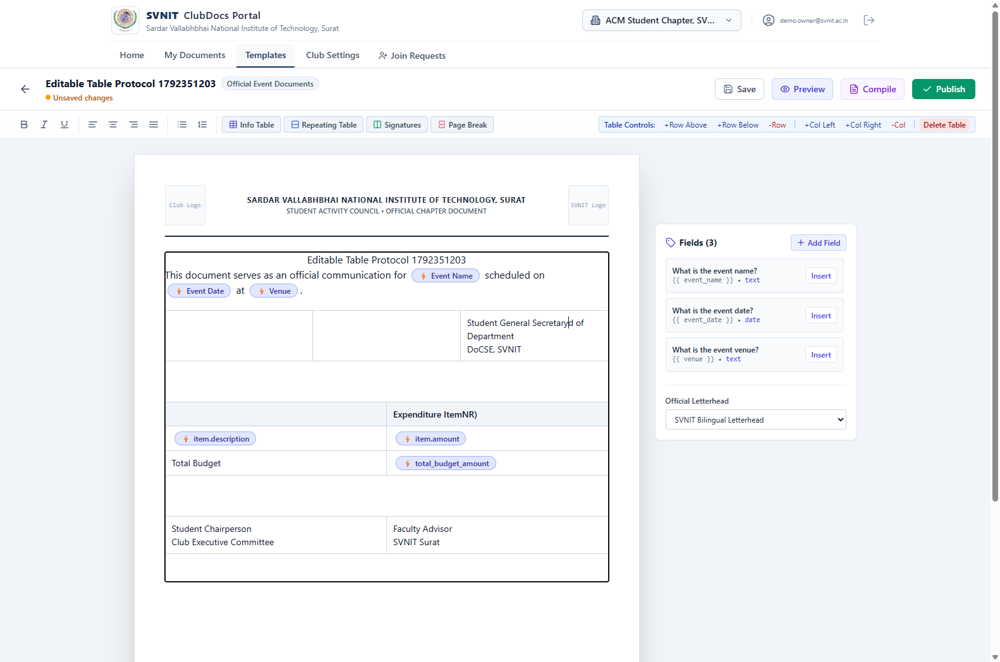

# SVNIT ClubDocs — Non-Technical Club Member User Guide

Welcome to **SVNIT ClubDocs**! This non-technical guide explains step-by-step how any club leader, secretary, or treasurer can create accounts, generate official packages, create templates, and download official PDFs without manual Word formatting or numbering errors.

---

## 1. Create an Account & Pick Your Club

### Creating an Account
1. Open the portal at [http://localhost:8000](http://localhost:8000).
2. If you received an invite link (e.g. `http://localhost:8000/?invite=ACM-123456`), open it directly. Your club and assigned role are recognized automatically.
3. Otherwise, click **Sign Up**, enter your full name, SVNIT email (`@svnit.ac.in`), and password.
4. Select your club (e.g. *Association for Computing Machinery (ACM)*). If you are creating a new club, type the new club name and chapter code.
5. Choose your position (Student Head, Secretary, Treasurer, Committee Member, or Other).
6. Click **Submit**. If joining an existing club, a pending join request is routed to your club administrator for quick 1-click approval.

---

## 2. Describe What You Need (Home)

1. Navigate to the **Home** tab.
2. In the central box labeled **"What do you need?"**, type your requirements in plain conversational language:
   > *"We are organizing TechNova on 15 Nov 2026, 10 AM to 5 PM in the CSE Seminar Hall. We need permission, sanction note with 25000 budget, and cash prizes of 5000 and 3000."*
3. Or tap one of the suggested example chips below the text box.
4. Click **Understand & Suggest Documents**.

---

## 3. Review What Was Understood & Answer Questions

The engine extracts details automatically into clean, editable cards:
- **Event Name & Purpose**: Review and edit if needed.
- **Date & Timings**: Handled via clean calendar pickers (`DD/MM/YYYY`) and native time pickers (e.g. `10:00 AM` to `05:00 PM`).
- **Venue**: Picked from the SVNIT venue directory or select "Other".
- **Money & Budget**: Displayed with Indian grouping (e.g. `₹25,000.00`).
- **AI-Suggested Content**: Any AI-drafted description or summary is tagged `[AI-drafted, review]`. Click **Accept AI Draft** to approve it.
- **Reserve Serial Numbers**: Tick the checkbox confirming the sequential reference numbers (e.g. `ACM/26-27/ROOM/001`) that will be officially reserved upon generation.

---

## 4. Generate & Download Your Documents

1. Click **Generate Documents**.
2. Within seconds:
   - Official sequential reference numbers are allocated without collisions.
   - Word DOCX files are compiled.
   - SVNIT-compliant PDFs are generated via headless LibreOffice.
   - A single coordinated ZIP archive is assembled.
3. On the result screen, you can:
   - Preview individual PDFs directly in the browser.
   - Download individual `.pdf` or `.docx` files.
   - Click **Download Batch ZIP** to download the entire package at once.

---

## 5. Finding Past Documents

1. Click **My Documents** in the navigation bar.
2. Search by reference number (`ACM/26-27/ROOM/001`) or event title (`TechNova`).
3. Click any document to view its creation history, author details, and download fresh copies.

---

## 6. Creating a Template by Describing It (AI)

1. Click **Templates** in the navigation bar.
2. In the prominent **"Create a template by describing it"** card:
   - Type your requirements: e.g. *"A permission letter to the Dean of Student Welfare requesting sound system permission for our open-air amphitheater cultural night."*
3. Click **Draft with AI**.
4. The system drafts the structure, fields, and letterhead layout, and opens it directly in the visual editor for your inspection and review.

---

## 7. Building or Customizing a Template Manually

1. On the **Templates** tab, click **New Blank Template** or click **Customize** on any standard template.
2. The visual editor opens in an A4 desk view:
   - Type anywhere just like in Microsoft Word.
   - Type `/` to open the slash menu (add headings, info tables, repeating budget tables, or signature grids).
   - Use the right-hand **Fields Panel** to insert dynamic placeholders like `{{ event_name }}` or `{{ date }}` with one click.
   - Click **Live Preview** to preview the exact PDF output before publishing.
   - Click **Publish** to make it available for all club members.

---

## 8. Sharing & Club Collaboration

- Club administrators can invite team members by navigating to **Club Settings → Members** and clicking **Invite Member**.
- Copy the unique invite link and share it over WhatsApp or email.
- New members join with pre-assigned permissions, ready to generate documents instantly.
